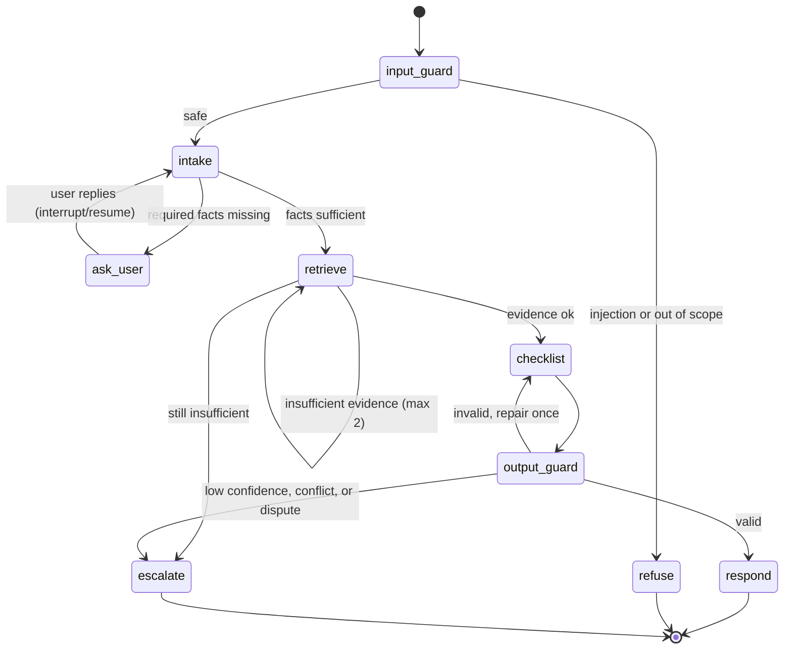
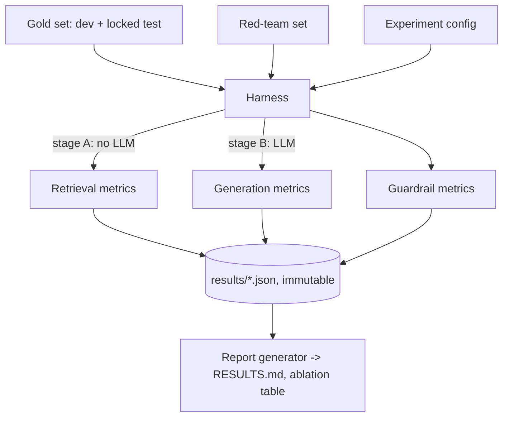

# Heirs Claims Navigator: Architecture Design

**Status:** design of record for v1. Companion to `HEIRS_NAVIGATOR_BUILD_PLAN_v2.md`.
**Rule:** if the implementation needs to deviate from this document, write an ADR (`docs/adr/`) first.
**Verification flags:** items marked **[verify]** depend on third-party behaviour that changes. Check current official documentation before relying on them, and record the result in an ADR.

---

## 1. Purpose and scope

A stateful, multi-agent assistant that helps the family of a deceased bank customer in India work out **which documents and steps they need** to claim deposit accounts, safe deposit lockers and safe-custody articles. It answers from a curated corpus of regulator, statute and bank documents, cites every claim, protects personal data, and hands off to a human when it is unsure.

**In scope:** process and document guidance, per-case checklists, multi-session case memory, citations, guardrails, evaluation, a public demo.
**Out of scope:** legal advice (who should inherit, how to win a dispute, tax), filing claims, handling real personal data, any paid service. All demo cases are synthetic.

### 1.1 Quality attributes (in priority order)
1. **Correctness and groundedness:** answers match the source documents and say so with citations.
2. **Safety:** no PII leakage, no legal advice, robust to prompt injection (direct and indirect).
3. **Measurability:** every claim about quality is backed by a recorded baseline and a locked test set.
4. **Zero cost:** runs on free tiers only. Design for rate limits and sleeping hosts.
5. **Explainability:** a reviewer can see why the system said what it said (trace, citations, state).

### 1.2 Hard constraints
| Constraint | Source | Design consequence |
|---|---|---|
| Groq free tier: per-model limits, for `openai/gpt-oss-120b` about 30 req/min, 1,000 req/day, 8,000 tokens/min, 200,000 tokens/day **[verify on the Groq limits page]** | Groq docs | Token budgeting, small prompts, resumable evaluation spread over days, LLM-free evaluation wherever possible |
| LangSmith Developer plan: 5,000 traces/month, 14-day retention, hard cap without a card | LangSmith pricing | Sample traces; local JSONL logs are the system of record |
| Streamlit Community Cloud: about 1 GB RAM, sleeps after about 12 h idle, requires a GitHub repo | Streamlit docs | CPU-only ONNX inference, prebuilt index, memory test, ephemeral state |
| Hugging Face Gradio and Docker Spaces need a paid plan | HF pricing | Not used |
| No payment method on any account | Owner | Every external dependency has a free-tier fallback or a replay mode |

---

## 2. System overview

```mermaid
flowchart LR
  subgraph Offline["Offline build (local machine, make targets)"]
    S[sources.yaml] --> F[Fetch + OCR]
    F --> P[Parse to pages]
    P --> C[Structure-aware chunking + metadata]
    C --> E[Embed (ONNX)]
    E --> I[(Chroma index)]
    C --> B[(BM25 index)]
    F --> M[(manifest.csv)]
  end

  subgraph Online["Online path (per user turn)"]
    UI[Streamlit chat UI] --> IG[Input guard]
    IG -->|safe| INT[Intake agent]
    IG -->|injection / out of scope| REF[Refusal]
    INT -->|missing facts| ASK[Ask user]
    INT --> RET[Retrieval agent]
    RET --> CHK[Checklist agent]
    CHK --> OG[Output guard]
    OG -->|valid| RESP[Respond with citations]
    OG -->|invalid| CHK
    OG -->|low confidence / disputed| ESC[Human handoff summary]
    RET -->|insufficient evidence| ESC
  end

  I --> RET
  B --> RET
  M --> RET
  GW[LLM gateway: routing, cache, ledger, retries] --- INT
  GW --- RET
  GW --- CHK
  CK[(SQLite checkpointer)] --- INT
  CK --- CHK

  subgraph Eval["Evaluation (offline)"]
    G1[Gold set] --> H[Harness]
    R1[Red-team set] --> H
    H --> RES[(Immutable results)]
    H --> GW
  end
```

Three subsystems with one shared core:
- **Offline build:** turns documents into an index. Deterministic, versioned, runs on the owner's machine.
- **Online path:** the LangGraph application that serves a conversation.
- **Evaluation:** replays gold and red-team sets through the **same** online code and records immutable results.

---

## 3. Component design

### 3.1 Corpus and ingestion (`src/heirs_navigator/ingest/`)
- `data/sources.yaml` declares every document: `doc_id, title, issuer, doc_type, url, effective_date, status (final|draft|superseded), bank`.
- `fetch` downloads, hashes (SHA-256) and stores raw files; failures go to `data/MISSING.md` for manual download. `ocr` runs only on scanned files.
- `parse` produces page-level records `{doc_id, page, text}` and preserves page numbers.
- `chunk` is **structure-aware**: detects clause and paragraph numbering and headings, keeps table rows intact, never splits a numbered clause unless it exceeds the size limit. Target 250 to 350 tokens per chunk to keep prompts small under the token budget. Every chunk carries metadata: `doc_id, section, page, issuer, doc_type, bank, effective_date, status, chunk_id`.
- `index` builds a Chroma collection (dense) and a BM25 index from the same chunks. The index directory records the **manifest hash**, so a stale index is detected at load time.
- The deployed app loads a **prebuilt index**. It never embeds the corpus at runtime.

### 3.2 Retrieval (`src/heirs_navigator/retrieval/`)
Pipeline per sub-query:
1. **Metadata prefilter:** exclude `status in {draft, superseded}` by default; restrict to the named bank (plus regulator and statute documents) when a bank is known; prefer the latest `effective_date` when two documents conflict.
2. **Hybrid search:** dense (bge-small class model through ONNX **[verify model availability]**) plus BM25, merged with reciprocal rank fusion.
3. **Rerank:** a small cross-encoder reranks the fused top-N (about 20) to top-k (about 4). Rerank scores are kept for confidence decisions.
4. **Evidence package:** the final chunks with ids, sources and dates, passed to the model as a numbered list. Models may cite only these ids.

**Agentic wrapper (a LangGraph subgraph):**
- **Router** (small model): classifies the question as `fact | scenario | multi_step | out_of_scope`.
- **Decomposer:** splits multi-step cases into sub-queries.
- **Sufficiency check:** if the evidence cannot support an answer, reformulate once or twice (maximum 2 retries), then escalate.
- Independent sub-queries run in parallel.

### 3.3 Orchestration (`src/heirs_navigator/graph/`)
A LangGraph state machine with a checkpointer. `thread_id` equals `case_id`.



**Case state (Pydantic):** `case_id`, `facts` (bank, product, nomination status and count, mode of operation, will status, dispute flag, amount band, claimant role), `docs_have`, `docs_missing`, `messages`, `evidence`, `checklist`, `flags`, `escalation`, `corpus_version`.

**Nodes**
| Node | Model tier | Responsibility |
|---|---|---|
| `input_guard` | rules plus small model | injection screening, scope check, PII masking |
| `intake` | small | slot-filling with structured output; asks only for facts still missing |
| `retrieve` | small (router, decomposer) | runs the retrieval subgraph |
| `checklist` | large | schema-validated checklist with citations |
| `output_guard` | rules (no model) | citation validity, PII scan, scope policy, confidence |
| `respond` | none | renders the answer with citations |
| `escalate` | small | PII-masked human-handoff summary |

### 3.4 LLM gateway (`src/heirs_navigator/platform/llm/`)
One module every model call goes through. No node calls a provider SDK directly.
- **Provider abstraction:** a small protocol with a Groq implementation, a fake implementation for tests, and a replay implementation (cached responses).
- **Model roles in config:** `router_model`, `generator_model`, `judge_model`, never hard-coded. Initial choices: small fast model for router and intake, `openai/gpt-oss-120b` for checklist and generation, a **different** model for the judge to avoid self-preference **[verify current free model lineup and limits]**.
- **Token ledger:** every call records model, role, tokens in and out, latency and cache status to a local JSONL ledger and a daily total. A **budget guard** checks the daily and per-minute budgets before each call and either waits (evaluation) or switches to replay or refusal (demo).
- **Rate limiter:** token-bucket per model, honouring `Retry-After` on 429. Evaluation runs are sequential by design.
- **Response cache:** keyed by hash of `(model, prompt, parameters, corpus_version)`. Persistent on disk. Evaluation reruns must be free.
- **Prompt structure for caching:** put the static system prompt and instructions first and the variable evidence last, because Groq reports automatic prompt caching on GPT-OSS models and says cached tokens do not count toward rate limits **[verify]**.
- **Structured output:** JSON-schema responses re-validated with Pydantic; one repair attempt; then fail closed.
- **Timeouts and retries:** timeout per call, exponential backoff with jitter, a retry cap, and a circuit breaker after repeated failures.

### 3.5 Guardrails (`src/heirs_navigator/guards/`)
Defence in depth. Each layer is independently testable.

| Layer | Where | What it does |
|---|---|---|
| **PII masking** | before any text reaches a model, a cache, a trace or a log | detects Aadhaar (with Verhoeff checksum), PAN, phone, email, bank account numbers, names where detectable; replaces with tokens; the token map lives in memory only and is never persisted **[verify Presidio India recognizers; otherwise custom recognizers]** |
| **Injection screening** | input guard | pattern checks plus a small-model classifier; also treats **retrieved documents as untrusted**, so instructions inside a document are never followed (indirect injection) |
| **Scope policy** | input and output guard | answers process and document questions; refuses who-should-inherit, dispute adjudication, tax and legal drafting; refusals redirect to the bank or a lawyer |
| **Citation validator** | output guard | every citation id must exist in the retrieved set and every quoted span must fuzzy-match its chunk; one repair attempt, then abstain |
| **Confidence and escalation** | output guard | escalate on low rerank score (threshold calibrated on dev only), source conflict, disputed case, or unresolved missing facts |
| **Output PII scan** | output guard | no unmasked identifiers in any response |

**Over-refusal is measured too.** A guard that refuses everything is useless, so the evaluation includes in-scope questions that must be answered.

### 3.6 State and persistence
- **Checkpointer:** SQLite (`langgraph-checkpoint-sqlite` **[verify package and API]**). Tests prove a case resumes after a process restart.
- **Deployed state is ephemeral** (Streamlit Community Cloud filesystem). That is acceptable for synthetic demo cases and is documented. Durable multi-session behaviour is demonstrated by the integration tests and the README.
- **PII never enters the checkpointer.** State stores masked tokens and structured facts, not raw identifiers.

### 3.7 User interface (`src/heirs_navigator/app/`)
Streamlit app: chat panel, case-state panel (facts known, documents held and missing), citations panel (source, section, effective date), escalation banner, permanent "not legal advice" notice, masked-PII indicator. Three preloaded synthetic cases. A **replay mode** serves recorded responses for those cases when the token budget is exhausted or the provider is unavailable.

### 3.8 Observability
- **Local JSONL logs are the system of record:** one record per node execution with case id (hashed), node, model, tokens, latency, guard decisions.
- **LangSmith** tracing is **sampled and switchable** (`LANGSMITH_TRACING` per run) to stay under 5,000 traces a month with 14-day retention. Export representative traces as screenshots for the README.
- **Metrics** are computed by the evaluation harness, not by a live monitoring stack.

---

## 4. Evaluation architecture



**Two stages, because tokens are scarce.**
- **Stage A (no LLM, free, fast):** retrieval ablations scored against gold documents and passages. Hit@k, MRR, context precision and recall, staleness-trap correctness. This covers most of the ablation rows.
- **Stage B (LLM, budgeted):** generation quality for **three** configurations only (naive baseline, best retrieval, final system), on the dev set, and the locked test set once.

**Deterministic scoring first.** Prefer programmatic metrics: citation validity, checklist item matching (normalised string and embedding match), abstention correctness, PII canary leaks, injection block rate. Use an LLM judge only where deterministic scoring cannot decide, with a fixed rubric and a fixed judge model recorded in every result. RAGAS faithfulness is run on a **subset** for baseline and final with the same judge.

**Statistical honesty.** The test set is small, so every headline metric carries a **bootstrap 95% confidence interval**. Temperature 0 and cached responses make reruns reproducible; latency is measured over repeated runs.

**Test discipline.** The test split is locked by hash in Week 1 and used once for the final evaluation.

---

## 5. Deployment architecture

```mermaid
flowchart LR
  GH[GitHub repo (public)] -->|push to main| SC[Streamlit Community Cloud]
  SC --> APP[App process: UI + graph + retrieval + prebuilt index]
  APP --> GQ[Groq API]
  APP --> LS[LangSmith (sampled)]
  U[Visitor] --> SC
  PG[GitHub Pages landing page] --> U
```

- **Single process, CPU only.** ONNX inference for embeddings and reranking, so PyTorch is not needed at runtime **[verify; fall back to a smaller model if the memory test fails]**.
- **Secrets** through Streamlit secrets; never in the repo.
- **Memory:** target under 800 MB RSS under demo load, measured locally with a memory cap.
- **Sleep:** the app hibernates after about 12 hours without traffic and shows a wake-up page. The landing page says so.
- **Abuse and cost protection:** per-session turn limits, an input length cap, and the global budget guard. When the daily token budget is exhausted, the app serves replay mode and says so plainly.
- **Redistribution of corpus text** must be reviewed per source before the index is committed to a public repository (owner checkpoint). Default to government and regulator documents; fetch bank documents on the owner's machine.

---

## 6. Security and privacy threat model

| Threat | Vector | Mitigation | Test |
|---|---|---|---|
| Direct prompt injection | user message | input guard, instruction hierarchy, schema-constrained output | red-team set |
| **Indirect injection** | instructions planted in a retrieved document | retrieved text treated as data; guard on output; injected test document in a separate test corpus | red-team set |
| PII leakage to model, logs, traces or cache | user messages and documents | mask before any external or persistent sink; in-memory token map | canary PII test across every sink |
| Legal-advice overreach | in-scope-looking questions | scope policy, refusal templates | out-of-scope gold questions |
| Hallucinated citations | model | citation validator, abstain on failure | fabricated-citation unit tests |
| Stale rules | draft or superseded documents | status filter, effective-date preference | trap questions |
| Cost abuse (burning the free quota) | public demo | per-session limits, global budget guard, replay mode | functional test with a zero budget |
| Secret exposure | repo, logs | secrets in env only, scanning in CI | CI secret scan |
| Supply-chain risk | dependencies | pinned versions, audit in CI | `pip-audit` in CI |

---

## 7. Failure modes and degradation

| Failure | Behaviour |
|---|---|
| Groq 429 or outage | backoff and retry within limits; evaluation pauses and resumes later; demo switches to replay mode |
| Daily token budget exhausted | evaluation stops cleanly with a checkpoint; demo switches to replay mode |
| Retrieval returns weak evidence | one or two reformulations, then escalate to the human-handoff summary |
| Citation validation fails twice | abstain with an explanation and the sources found |
| Index and manifest hash mismatch | refuse to start and print the rebuild command |
| Checkpointer unavailable | continue statelessly, warn the user that the case will not be remembered |
| Memory pressure on the free host | smaller batch sizes; documented fallback to a smaller model |

---

## 8. Capacity and token budget (planning model)

Estimates to confirm with the ledger in Week 1; every figure is a planning assumption, not a measurement.

| Item | Assumption |
|---|---|
| Prompt per generation | about 0.5K system and instructions plus 4 chunks of about 300 tokens ≈ 1.7K, plus about 0.4K output ≈ 2.1K tokens |
| One dev generation pass (60 questions) | about 125K tokens, which is most of one day's quota on the large model |
| Stage B total | 3 configurations on dev plus the test set once ≈ 200+ generations ≈ 450K tokens, plus judging, so **plan on 5 to 8 calendar days of quota** |
| Mitigations | route intake and routing to a small model with a separate quota, cache everything, keep chunks small, deterministic scoring first, resumable runs |

The evaluation runner must be **resumable per question** and pause when 90% of a model's daily budget is used.

---

## 9. Key design decisions (record each as an ADR)

| # | Decision | Rationale |
|---|---|---|
| 1 | LangGraph state machine with checkpointing | explicit control flow, resumable cases, testable nodes |
| 2 | Four main nodes plus guards, not six agents | fewer moving parts, clearer evaluation |
| 3 | Central LLM gateway with ledger, cache and budget guard | free-tier survival and reproducibility |
| 4 | Deterministic scoring first, LLM judge second | scarce tokens, defensible metrics |
| 5 | Stage A (no LLM) retrieval ablations | most of the ablation story at zero token cost |
| 6 | ONNX CPU inference and a prebuilt index | fits a 1 GB host |
| 7 | Structure-aware chunking with status and date metadata | staleness handling is a first-class feature |
| 8 | Streamlit Community Cloud with replay mode | free hosting that survives quota exhaustion |
| 9 | PII masked before every sink | privacy by construction |
| 10 | Local JSONL logs as record, sampled LangSmith | trace quota is small |

---

## 10. Verification checklist (Week 1, before relying on these)
- Current Groq free-tier limits and model availability for each configured role.
- Whether the chosen ONNX embedding and reranker models are available and fit the memory target.
- LangGraph checkpointer package names and the interrupt and resume API in the installed version.
- Presidio built-in India recognizers, or custom recognizers with Verhoeff validation.
- LangSmith free-tier trace cap behaviour with sampling.
- Streamlit Community Cloud current memory limits.
